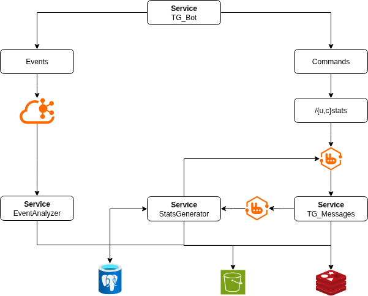
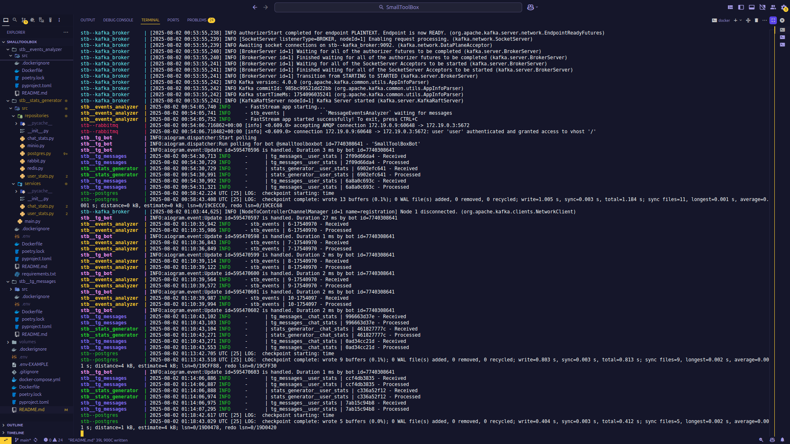

# SmallToolBox - Telegram Bot

> [!NOTE]
> Brief: [Project Diagram and Screenshots](./readme/SCREENSHOTS.md) | [TODO List](./readme/TODO.md)\
> Demo: [Telegram Group](https://t.me/smalltoolbox) | [Telegram Bot](https://t.me/smalltoolboxbot)

```
# `matplotlib.pyplot.plot` (image) Generators
/uStats - Sent Messages count in Chats
/cStats - Sent Messages and Users count
```

<details>
<summary>Dependencies</summary>
<pre>
psql -V               # psql (PostgreSQL) 15.7 (Ubuntu 15.7-0ubuntu0.23.10.1)
poetry -V             # Poetry (version 1.8.3)
poetry run python -V  # Python 3.11.6
</pre>
</details>

<details>
<summary>Stop and Remove containers</summary>

  ```bash
  docker compose down --rmi all --remove-orphans --volumes
  ```

  ```
  [+] Running 26/26
  ✔ Container stb__tg_bot              Removed
  ✔ Container stb__stats_generator     Removed
  ✔ Container stb__events_analyzer     Removed
  ✔ Container stb--kafka_broker        Removed
  ✔ Container stb__tg_messages         Removed
  ✔ Container stb--postgres            Removed
  ✔ Container stb--minio               Removed
  ✔ Container stb__core                Removed
  ✔ Container stb--rabbitmq            Removed
  ✔ Container stb--redis               Removed
  ! Image postgres:latest              Resource is still in use
  ✔ Image stb__core:v0.2.0             Removed
  ✔ Image stb__events_analyzer:v0.1.0  Removed
  ✔ Image rabbitmq:latest              Removed
  ✔ Image redis:latest                 Removed
  ✔ Image stb__events_analyzer:v0.2.0  Removed
  ✔ Image apache/kafka:latest          Removed
  ✔ Image quay.io/minio/minio:latest   Removed
  ✔ Image stb__core:v0.1.0             Removed
  ✔ Image stb__stats_generator:v0.1.0  Removed
  ✔ Image stb__tg_messages:v0.2.0      Removed
  ✔ Image stb__tg_bot:v0.2.0           Removed
  ✔ Image stb__tg_messages:v0.1.0      Removed
  ✔ Image stb__stats_generator:v0.2.0  Removed
  ✔ Image stb__tg_bot:v0.1.0           Removed
  ✔ Network smalltoolbox_default       Removed
  ```
</details>

```
# Set an Environment variable: $TGBOT__TOKEN
cp .env-EXAMPLE .env

docker compose up -d
```

#### Versions
- **0.2.0**
  - [x] Monolith to Microservices
- **0.1.0**
  - [x] Implemented Commands: `uStats`, `cStats`

---

<p align="center">
  
  
</p>
